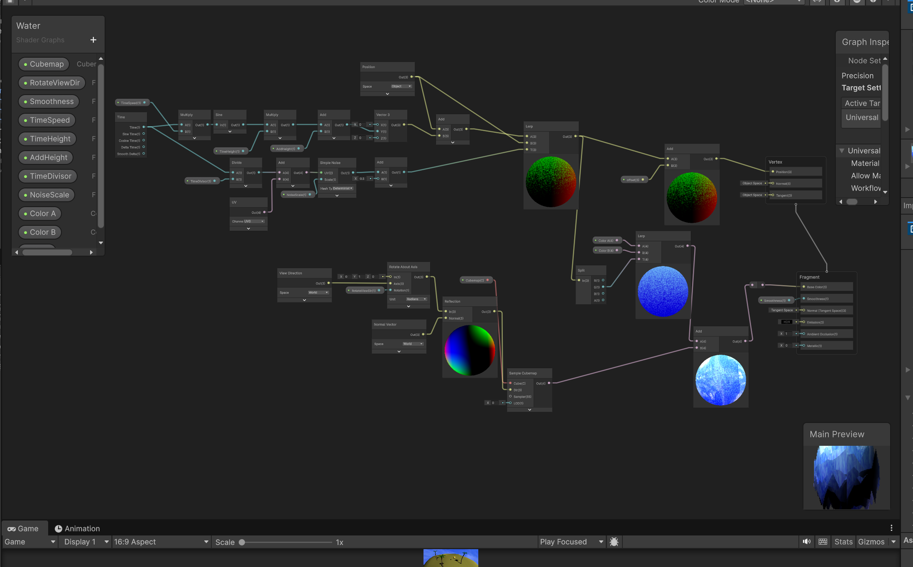
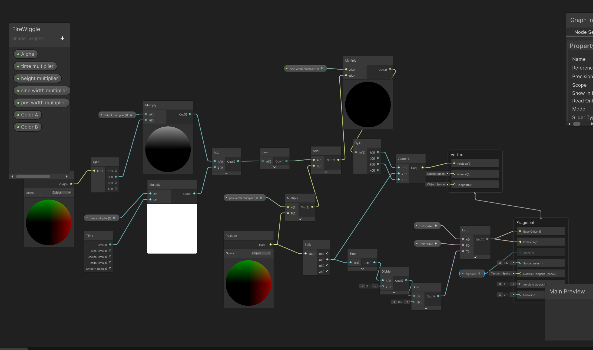

# comp graphics project
Burr Anderson

- water shader, uses a cubemap with an image of the sky alongside sine waves and noise to appear as moving water

- fire shader, uses a sine wave to "wiggle" the fire, alongside emissions and alpha to make it emit light and translucent. 
- The colors also use a sine wave to vary along the height of the fire.
Jacob Coleman
Zehra Suleman
https://docs.google.com/document/d/1WpICWOhZylKiqK6zDBZAsAWr7lVRbFpCSJHpwwjpjZU/edit?tab=t.0